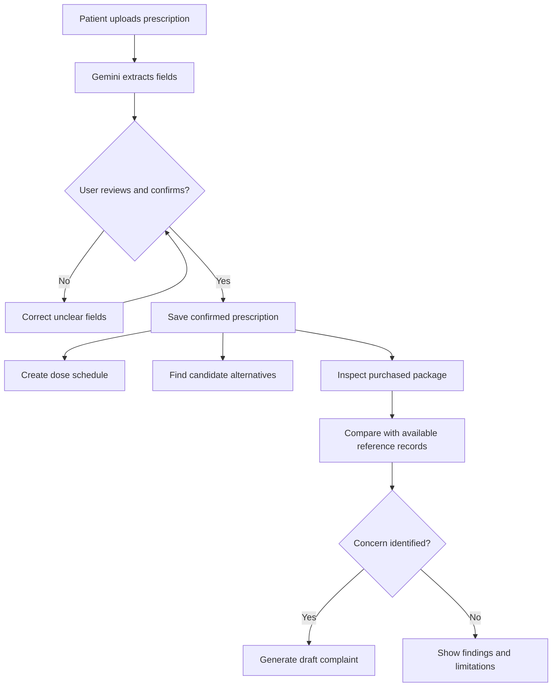
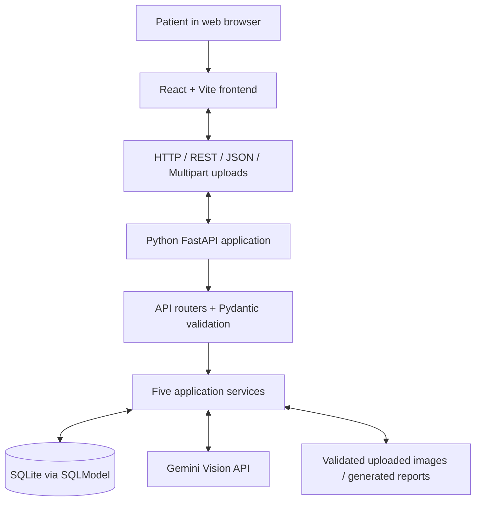
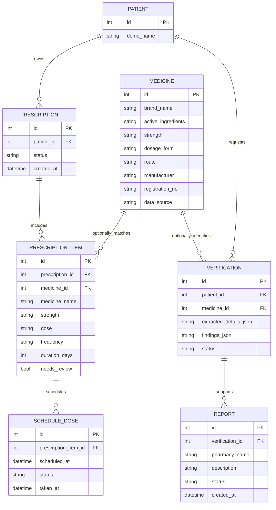
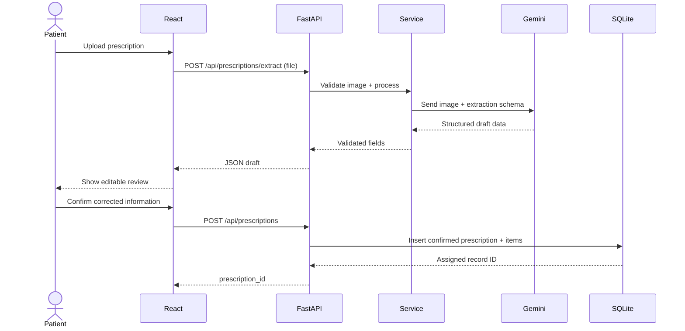
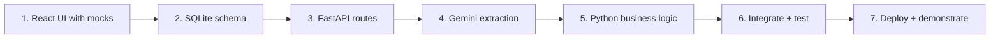

# After Dr — Complete System Architecture & 24-Hour Implementation Roadmap

> **Project:** After Dr — Post-Consultation Medicine Assistant
> **Team:** Five developers
> **Build window:** 24 hours (hackathon MVP)
> **Stack:** React + Vite + Tailwind CSS · Python + FastAPI · SQLModel + SQLite · Gemini Vision API
> **Purpose:** Educational prototype using fictional patient records and a clearly identified demonstration medicine catalog.

---

## Table of Contents

1. [Product scope and MVP definition](#1-product-scope-and-mvp-definition)
2. [Architecture and major design decisions](#2-architecture-and-major-design-decisions)
3. [Repository structure](#3-repository-structure)
4. [Phase 1 — Frontend first](#4-phase-1--frontend-first)
5. [Phase 2 — Database design and connection](#5-phase-2--database-design-and-connection)
6. [Phase 3 — REST API contracts and React integration](#6-phase-3--rest-api-contracts-and-react-integration)
7. [Phase 4 — Gemini AI integration](#7-phase-4--gemini-ai-integration)
8. [Phase 5 — Backend logic for all five features](#8-phase-5--backend-logic-for-all-five-features)
9. [Phase 6 — Connect the modules end-to-end](#9-phase-6--connect-the-modules-end-to-end)
10. [Phase 7 — Testing and safety checks](#10-phase-7--testing-and-safety-checks)
11. [Phase 8 — Deployment](#11-phase-8--deployment)
12. [24-hour sprint plan and team allocation](#12-24-hour-sprint-plan-and-team-allocation)
13. [AI coding-agent prompts](#13-ai-coding-agent-prompts)
14. [Acceptance criteria and demo script](#14-acceptance-criteria-and-demo-script)
15. [Troubleshooting and future improvements](#15-troubleshooting-and-future-improvements)

---

## 1. Product scope and MVP definition

**After Dr** helps a patient manage the tasks that follow a doctor's visit. Build only these five modules for the initial MVP:

| # | Feature | Patient input | Output | Implementation |
|---|---|---|---|---|
| 1 | **AI Prescription Reader** | Image of printed/handwritten prescription | Editable, structured medication instructions | Gemini image understanding + structured validation |
| 2 | **Medicine Scheduler** | Confirmed instructions + selected reminder times | Dose schedule; Taken / Missed / Pending tracking | Python datetime + database |
| 3 | **Alternative Medicine Finder** | Prescribed medicine | Candidate products with matching documented attributes | Curated medicine database + deterministic filtering |
| 4 | **Medicine Safety Checker** | Photo of medicine packaging | Extracted package information, record comparisons, concerns | Gemini extraction + reference-data checks |
| 5 | **Suspicious Medicine Reporting** | Verification result + purchase/seller details | Downloadable complaint draft for DRAP | Database + PDF generation |

### What the MVP is **not**

- Not an automatic medical prescriber or diagnostic system.
- Not an authority that can authorize a drug substitution.
- Not a reliable fake-versus-genuine classifier based on packaging photos.
- Not an official DRAP submission integration. The MVP generates a **draft**, not a submitted complaint.
- Not a real-world patient information system with full privacy/compliance controls.
- Not a mobile push-notification service that works with the website closed.

**Demo rule:** Use synthetic prescriptions, test packaging, and clearly labeled synthetic/curated reference records. Do not expose real patient or prescription information during the hackathon.

### Intended patient journey



---

## 2. Architecture and major design decisions

### 2.1 High-level architecture



### 2.2 Responsibilities

| Layer | Technology | Responsibilities | Must **not** do |
|---|---|---|---|
| Presentation | React, Tailwind, React Router | Navigation, upload, review forms, schedules, status displays | Contain API secrets or access SQLite directly |
| Frontend API client | Axios / `fetch` | Call FastAPI endpoints; translate loading/error responses | Invent medical verification outcomes |
| REST API | FastAPI routers | Request validation, response schemas, status codes, basic access checks | Hold large business workflows inline |
| Application services | Python modules | AI extraction, scheduling, matching, verification, reports | Trust arbitrary AI output without validation |
| Persistence | SQLModel + SQLite | Store linked records and transactions | Independently decide medication instructions |
| AI provider | Gemini Vision | Transcribe visible information from images into structured outputs | Verify authenticity or approve substitutions |

### 2.3 Architectural decisions

1. **Modular monolith:** One FastAPI process, not five microservices.
2. **One repository:** Separate `frontend/` and `backend/` folders in a monorepo.
3. **Frontend-first UI:** Mock API responses enable designing before backend endpoints exist.
4. **Database is the source of truth:** The frontend does not own authoritative persistent records.
5. **Human confirmation:** AI-extracted prescription text is treated as an unverified draft until reviewed.
6. **Only the backend calls Gemini:** Do not put Gemini credentials in browser code.
7. **Rule-based critical operations:** Scheduling and medicine matching use explicit, testable rules.
8. **Demo-first deployment:** A stable local demo takes priority over production hosting.

> **Build-order nuance:** You can *design* the frontend and database before the API, but the frontend can only access SQLite **through FastAPI**, not directly.

---

## 3. Repository structure

```text
after-dr/
├── frontend/
│   ├── public/
│   ├── src/
│   │   ├── components/
│   │   │   ├── layout/
│   │   │   │   ├── Navbar.jsx
│   │   │   │   ├── Sidebar.jsx
│   │   │   │   └── DashboardLayout.jsx
│   │   │   ├── medicine/
│   │   │   │   ├── MedicineCard.jsx
│   │   │   │   └── MedicineTable.jsx
│   │   │   └── common/
│   │   │       ├── FileUploader.jsx
│   │   │       ├── LoadingState.jsx
│   │   │       ├── ErrorMessage.jsx
│   │   │       └── StatusBadge.jsx
│   │   ├── pages/
│   │   │   ├── LandingPage.jsx
│   │   │   ├── DashboardPage.jsx
│   │   │   ├── PrescriptionPage.jsx
│   │   │   ├── SchedulerPage.jsx
│   │   │   ├── AlternativesPage.jsx
│   │   │   ├── VerificationPage.jsx
│   │   │   └── ReportingPage.jsx
│   │   ├── services/
│   │   │   └── api.js
│   │   ├── mocks/
│   │   │   └── demoData.js
│   │   ├── App.jsx
│   │   ├── main.jsx
│   │   └── index.css
│   ├── .env.example
│   └── package.json
├── backend/
│   ├── app/
│   │   ├── __init__.py
│   │   ├── main.py
│   │   ├── database.py
│   │   ├── models.py
│   │   ├── schemas.py
│   │   ├── routers/
│   │   │   ├── __init__.py
│   │   │   ├── prescriptions.py
│   │   │   ├── schedules.py
│   │   │   ├── medicines.py
│   │   │   ├── verification.py
│   │   │   └── reports.py
│   │   ├── services/
│   │   │   ├── __init__.py
│   │   │   ├── gemini_service.py
│   │   │   ├── prescription_service.py
│   │   │   ├── schedule_service.py
│   │   │   ├── alternative_service.py
│   │   │   ├── verification_service.py
│   │   │   └── report_service.py
│   │   └── repositories/
│   │       └── medicine_repository.py
│   ├── data/
│   │   └── demo_medicines.csv
│   ├── tests/
│   ├── .env.example
│   └── requirements.txt
├── .gitignore
└── README.md
```

**Naming rule:** In all following Python examples, the backend is started from `backend/` with `uvicorn app.main:app --reload`; imports use `from app...`.

---

## 4. Phase 1 — Frontend first

**Time:** Hours 0–4
**Objective:** All pages and user interactions work using mock data.

### Step 1 — Create the React project

```bash
npm create vite@latest frontend -- --template react
cd frontend
npm install
npm install axios react-router-dom lucide-react
npm run dev
```

Open `http://localhost:5173`.

Install/configure Tailwind using its current Vite integration instructions, or preserve the styling approach generated by your frontend design tool.

### Step 2 — Create the pages

| Screen | Key UI requirements |
|---|---|
| Landing | Hero, value proposition, five features, demo entry |
| Dashboard | Confirmed prescriptions, next dose, today's summary, navigation |
| Prescription Reader | Upload image, preview, processing state, editable extracted table, confirm button |
| Scheduler | Medicine schedule, time chooser, daily calendar, Taken/Missed/Pending controls |
| Alternatives | Prescribed medicine lookup, candidate comparison, review warning |
| Safety Checker | Package image upload, extracted fields, match/inconsistency/unverified results |
| Reporting | Prefilled findings, seller details, evidence, preview, download draft |

Design mobile layouts and loading, empty, success, and failure states. If the UI is generated by an AI design agent, instruct it to read and apply its available frontend-design skills.

### Step 3 — Use mock data

`frontend/src/mocks/demoData.js`:

```javascript
export const demoPrescription = {
  id: 101,
  status: "needs_review",
  medicines: [
    {
      id: 201,
      name: "Demo Medicine A",
      strength: "500 mg",
      dose: "1 tablet",
      frequency: "Twice daily",
      duration_days: 5,
      needs_review: false,
    },
  ],
};
```

Give each page a mock service with the same response shape as the future FastAPI endpoint. Explicitly label mock verification findings as simulated.

### Step 4 — Centralize HTTP calls

`frontend/src/services/api.js`:

```javascript
import axios from "axios";

const api = axios.create({
  baseURL: import.meta.env.VITE_API_BASE_URL || "http://localhost:8000/api",
  timeout: 30000,
});

export async function extractPrescription(file) {
  const formData = new FormData();
  formData.append("file", file);
  const response = await api.post("/prescriptions/extract", formData, {
    timeout: 60000,
  });
  return response.data;
}

export async function getTodaySchedule() {
  const response = await api.get("/schedules/today");
  return response.data;
}

export async function searchMedicine(query) {
  const response = await api.get("/medicines/search", { params: { q: query } });
  return response.data;
}

export default api;
```

Create `frontend/.env`:

```dotenv
VITE_API_BASE_URL=http://localhost:8000/api
```

> Vite variables prefixed `VITE_` are exposed to browser code. **Never store Gemini API keys or other secrets in the frontend.**

### Step 5 — Wire a simple upload component

```jsx
import { useState } from "react";
import { extractPrescription } from "../services/api";

export default function PrescriptionUploader() {
  const [file, setFile] = useState(null);
  const [result, setResult] = useState(null);
  const [loading, setLoading] = useState(false);
  const [error, setError] = useState("");

  async function handleUpload() {
    if (!file) return;
    setLoading(true);
    setError("");
    try {
      setResult(await extractPrescription(file));
    } catch {
      setError("Could not process the image. Please try again.");
    } finally {
      setLoading(false);
    }
  }

  return (
    <section>
      <input
        type="file"
        accept="image/png,image/jpeg"
        onChange={(e) => setFile(e.target.files?.[0] ?? null)}
      />
      <button onClick={handleUpload} disabled={!file || loading}>
        {loading ? "Reading…" : "Read Prescription"}
      </button>
      {error && <p role="alert">{error}</p>}
      {result && <pre>{JSON.stringify(result, null, 2)}</pre>}
    </section>
  );
}
```

Replace the `<pre>` with your final editable review form; it is just an integration smoke test.

**Phase 1 exit criteria**

- [ ] All seven pages load.
- [ ] Navigation works on desktop and mobile.
- [ ] Every module has realistic mock interactions.
- [ ] API calls are isolated in `services/api.js`.
- [ ] Mock output is distinguishable from real extraction/verification.

---

## 5. Phase 2 — Database design and connection

**Time:** Hours 3–6, overlapping the frontend
**Objective:** Persist patients, prescriptions, doses, reference medicines, checks, and reports.

### Step 6 — Define entities and relationships



**Notes:** Medicine references on prescription items and verification records can be nullable. Preserve the original prescribed name even when a reference catalog entry cannot be matched. Evidence files can be stored separately and referenced by ID; never put large image blobs in a JSON response.

### Step 7 — Install Python packages

```bash
cd backend
python -m venv .venv
```

Activate on Windows PowerShell:

```powershell
.venv\Scripts\Activate.ps1
```

Or macOS/Linux:

```bash
source .venv/bin/activate
```

Install dependencies:

```bash
pip install fastapi "uvicorn[standard]" sqlmodel python-multipart google-genai python-dotenv pillow reportlab pytest
pip freeze > requirements.txt
```

### Step 8 — Create the database engine

`backend/app/database.py`:

```python
from sqlmodel import SQLModel, Session, create_engine

DATABASE_URL = "sqlite:///./medcare.db"
engine = create_engine(
    DATABASE_URL,
    connect_args={"check_same_thread": False},
)

def create_db():
    SQLModel.metadata.create_all(engine)

def get_session():
    with Session(engine) as session:
        yield session
```

### Step 9 — Implement the models

Start with `backend/app/models.py`:

```python
from sqlmodel import SQLModel, Field

class Medicine(SQLModel, table=True):
    id: int | None = Field(default=None, primary_key=True)
    brand_name: str
    active_ingredient: str
    strength: str
    dosage_form: str
    route: str
    manufacturer: str | None = None
    registration_no: str | None = None
    data_source: str = "demo_dataset"
```

Create the remaining models from the entity diagram. Define relationships and foreign keys, and use database constraints for dose scheduling where possible.

**Data modeling improvement for later:** Store ingredients as structured components instead of a single free-text field when supporting combination medicines or sophisticated matching.

### Step 10 — Initialize with FastAPI

`backend/app/main.py`:

```python
from contextlib import asynccontextmanager
from fastapi import FastAPI
from fastapi.middleware.cors import CORSMiddleware
from app.database import create_db
from app import models  # ensures SQLModel knows the tables

@asynccontextmanager
async def lifespan(app: FastAPI):
    create_db()
    yield

app = FastAPI(title="After Dr API", lifespan=lifespan)

app.add_middleware(
    CORSMiddleware,
    allow_origins=["http://localhost:5173"],
    allow_credentials=False,
    allow_methods=["GET", "POST", "PATCH"],
    allow_headers=["Content-Type", "Authorization"],
)

@app.get("/api/health")
def health():
    return {"status": "ok"}
```

Run from `backend/`:

```bash
uvicorn app.main:app --reload
```

Test:

- Health: `http://localhost:8000/api/health`
- Interactive API docs: `http://localhost:8000/docs`

The expected health response is `{"status":"ok"}`.

**Phase 2 exit criteria**

- [ ] SQLite tables create successfully.
- [ ] Database can insert and read a test medicine.
- [ ] FastAPI health endpoint works.
- [ ] Schema, model names, and JSON contracts are shared with teammates.

---

## 6. Phase 3 — REST API contracts and React integration

**Time:** Hours 6–9
**Objective:** Frontend talks to FastAPI; start with stub responses and then replace them with real services.

### Step 11 — Freeze endpoint specifications

All endpoints below are prefixed with `/api`.

| Method | Endpoint | Request | Response |
|---|---|---|---|
| `GET` | `/health` | None | Server status |
| `POST` | `/prescriptions/extract` | Multipart image file | Unverified extracted fields |
| `POST` | `/prescriptions` | Confirmed prescription JSON | Saved prescription ID |
| `GET` | `/prescriptions/{id}` | ID | Prescription and items |
| `POST` | `/schedules` | Item ID, date, selected times, timezone | Dose records created |
| `GET` | `/schedules/today` | Demo user context | Today's doses |
| `PATCH` | `/schedules/{id}` | Dose status | Updated dose |
| `GET` | `/medicines/search?q=...` | Search string | Matching catalog products |
| `GET` | `/medicines/{id}/alternatives` | Catalog ID | Candidate equivalents |
| `POST` | `/verifications/extract` | Multipart package image | Unverified package details |
| `POST` | `/verifications` | Reviewed package data | Saved check and findings |
| `POST` | `/reports` | Verification ID + report info | Report draft ID |
| `GET` | `/reports/{id}/download` | Report ID | PDF file |
| `GET` | `/dashboard` | Demo user context | Combined dashboard summary |

### Step 12 — Agree on a prescription JSON contract

An AI extraction response:

```json
{
  "status": "needs_review",
  "patient_name": null,
  "doctor_name": null,
  "medicines": [
    {
      "name": "Demo Medicine A",
      "strength": "500 mg",
      "dose": "1 tablet",
      "frequency": "Twice daily",
      "duration_days": 5,
      "instructions": "After food",
      "needs_review": false
    }
  ]
}
```

No `prescription_id` is required during pure extraction. **The backend assigns IDs when records are saved** through the separate confirmation endpoint.

A confirmed save response:

```json
{
  "prescription_id": 101,
  "status": "confirmed",
  "medicine_count": 1
}
```

### Step 13 — Create a stub first

Before connecting Gemini, implement `/prescriptions/extract` with a clearly labeled synthetic response. Test it via FastAPI `/docs`, then from React. This isolates network/CORS/request-shape errors from AI issues.

### Step 14 — Understand the API call flow



**Phase 3 exit criteria**

- [ ] FastAPI `/docs` supports all defined routes (stubs are acceptable).
- [ ] React reaches the real `/api/health` endpoint.
- [ ] File upload works end-to-end with a stub extraction result.
- [ ] CORS is configured for the correct frontend origin.
- [ ] API shapes match frontend service expectations.

---

## 7. Phase 4 — Gemini AI integration

**Time:** Hours 9–12
**Objective:** Use Gemini for transcription tasks without trusting its text as verified clinical information.

### Step 15 — Configure the Gemini API key

Obtain a key from [Google AI Studio](https://aistudio.google.com/apikey). Select an **available, image-capable model** in your account; model IDs and access change over time.

`backend/.env`:

```dotenv
GEMINI_API_KEY=replace_with_your_private_key
GEMINI_MODEL=replace_with_available_image_capable_model
```

Add `.env` files and generated patient/test artifacts to `.gitignore`.

### Step 16 — Create one shared Gemini service

`backend/app/services/gemini_service.py`:

```python
import os
from dotenv import load_dotenv
from google import genai
from google.genai import types
from pydantic import BaseModel, Field

load_dotenv()

client = genai.Client(api_key=os.environ["GEMINI_API_KEY"])
MODEL = os.environ["GEMINI_MODEL"]

class MedicineExtraction(BaseModel):
    name: str | None = None
    strength: str | None = None
    dose: str | None = None
    frequency: str | None = None
    duration_days: int | None = None
    instructions: str | None = None
    needs_review: bool = True

class PrescriptionExtraction(BaseModel):
    patient_name: str | None = None
    doctor_name: str | None = None
    medicines: list[MedicineExtraction] = Field(default_factory=list)

def extract_prescription(image_bytes: bytes, mime_type: str) -> PrescriptionExtraction:
    response = client.models.generate_content(
        model=MODEL,
        contents=[
            "Extract only visible prescription information. Never guess unclear medicine names, strengths, dosage, frequency, or duration. Use null for illegible details and mark uncertain entries for review. Return the requested schema. This is transcription, not medical advice.",
            types.Part.from_bytes(data=image_bytes, mime_type=mime_type),
        ],
        config=types.GenerateContentConfig(
            response_mime_type="application/json",
            response_schema=PrescriptionExtraction,
        ),
    )
    if response.parsed is not None:
        return PrescriptionExtraction.model_validate(response.parsed)
    if not response.text:
        raise ValueError("Empty AI response")
    return PrescriptionExtraction.model_validate_json(response.text)
```

**Important:** Structured output validates format, not factual correctness. A person must check medical information against the original document. The model schema may need adjustment based on the selected Gemini SDK/model support.

### Step 17 — Add a validated upload endpoint

`backend/app/routers/prescriptions.py`:

```python
from io import BytesIO
from fastapi import APIRouter, File, HTTPException, UploadFile
from PIL import Image
from app.services.gemini_service import extract_prescription

router = APIRouter(prefix="/api/prescriptions", tags=["prescriptions"])
MAX_SIZE = 5 * 1024 * 1024
MIME = {"PNG": "image/png", "JPEG": "image/jpeg"}

@router.post("/extract")
def extract(file: UploadFile = File(...)):
    image_bytes = file.file.read(MAX_SIZE + 1)
    if len(image_bytes) > MAX_SIZE:
        raise HTTPException(status_code=413, detail="Image exceeds 5 MB")
    try:
        with Image.open(BytesIO(image_bytes)) as image:
            detected_format = image.format
            image.verify()
        mime_type = MIME[detected_format]
    except (KeyError, ValueError, OSError):
        raise HTTPException(status_code=400, detail="Invalid PNG/JPEG image")

    try:
        result = extract_prescription(image_bytes, mime_type)
        return {"status": "needs_review", **result.model_dump()}
    except Exception:
        # Log details privately on the backend, without logging patient images.
        raise HTTPException(status_code=502, detail="Extraction temporarily unavailable")
```

Register the router in `backend/app/main.py`:

```python
from app.routers.prescriptions import router as prescriptions_router
app.include_router(prescriptions_router)
```

**MVP hardening:** Protect against decompression bombs by limiting image dimensions and processing cost, add request timeouts/rate limits, and avoid logging sensitive content.

### Step 18 — Implement packaging extraction separately

Use the same Gemini client but a different Pydantic schema:

```text
PackageExtraction
- brand_name: str | null
- manufacturer: str | null
- registration_number: str | null
- batch_number: str | null
- expiry_date_text: str | null
- strength: str | null
- dosage_form: str | null
- needs_review: bool
```

The Gemini service **extracts what is visible only**. It does not decide authenticity.

**Phase 4 exit criteria**

- [ ] One synthetic printed prescription extracts to structured data.
- [ ] One unclear prescription produces an editable, review-required result.
- [ ] One mock package extracts visible product and batch fields.
- [ ] All AI API keys remain server-side.

---

## 8. Phase 5 — Backend logic for all five features

**Time:** Hours 12–17
**Objective:** Replace route stubs with deterministic, database-backed services.

### Module A — Prescription Reader

**Files:** `routers/prescriptions.py`, `services/prescription_service.py`, `services/gemini_service.py`.

1. Receive image upload.
2. Validate actual image content, file size, and processing limits.
3. Call Gemini for **unverified** extraction.
4. Validate shape using Pydantic.
5. Return the draft to React for an editable review.
6. Accept the reviewed information via `POST /api/prescriptions`.
7. Save one prescription and multiple prescription items in a database transaction.
8. Return the new prescription ID.

**Acceptance rule:** The system must not create a dose schedule from an unconfirmed prescription.

### Module B — Medicine Scheduler

**Files:** `routers/schedules.py`, `services/schedule_service.py`.

Input example:

```json
{
  "prescription_item_id": 201,
  "start_date": "2026-10-10",
  "duration_days": 5,
  "reminder_times": ["09:00", "21:00"],
  "timezone": "Asia/Karachi"
}
```

Processing:

1. Verify the prescription item exists and its parent prescription is confirmed.
2. Have the patient select/confirm exact reminder times (never derive them from vague directions by guessing).
3. Generate occurrences across the chosen dates.
4. Store each occurrence in `schedule_doses`.
5. Enforce a uniqueness rule to prevent duplicate occurrences.
6. Use UTC for stored timestamps, and convert to the display timezone.
7. Allow `pending`, `taken`, and `missed` statuses.
8. Return today's doses to the dashboard.

Example response:

```json
{
  "schedule_id": 12,
  "doses_created": 10,
  "status": "scheduled"
}
```

**24-hour scope:** In-app reminders and tracking, not guaranteed push notifications after the browser is closed.

### Module C — Alternative Medicine Finder

**Files:** `routers/medicines.py`, `services/alternative_service.py`.

1. Look up the original prescribed medicine in a reference catalog.
2. Compare **all active ingredients**, strength (normalized units), dosage form, route, and release type.
3. Exclude candidates with missing or conflicting attributes.
4. Return **potential** alternatives with explanations and source labels.
5. Require pharmacist/prescriber confirmation before substitution.

Simplified illustration:

```python
def matching_candidate(original, candidate):
    return (
        original.active_ingredient == candidate.active_ingredient
        and original.strength == candidate.strength
        and original.dosage_form == candidate.dosage_form
        and original.route == candidate.route
    )
```

This illustration is **not** sufficient for real medical equivalence. Combination products, release forms, normalized ingredient identities, and clinical exclusions require additional rules. Do not manufacture medicine products or registration numbers using a language model.

### Module D — Medicine Safety Checker

**Files:** `routers/verification.py`, `services/verification_service.py`, `services/gemini_service.py`.

1. Patient uploads a package photo.
2. Gemini extracts visible brand, manufacturer, registration, batch, and expiry information.
3. Patient reviews the extracted values.
4. Python searches an available trusted catalog or a clearly identified demo dataset.
5. Compare available records; flag mismatches and missing evidence.
6. Save the individual findings and the data source.
7. Return **one** of three statuses:

| Status | Display label | Interpretation |
|---|---|---|
| `record_match` | Record match found | Known fields match a reference record; does **not** prove genuineness |
| `inconsistent_information` | Potential inconsistency | Available details conflict and should be checked |
| `unable_to_verify` | Unable to verify | Trustworthy evidence is insufficient |

Example response:

```json
{
  "verification_id": 501,
  "status": "inconsistent_information",
  "findings": [
    {
      "field": "manufacturer",
      "result": "mismatch",
      "message": "Manufacturer differs from demo reference entry"
    }
  ],
  "counterfeit_confirmed": false,
  "source": "demo_dataset"
}
```

**Safety limitation:** Matching a company or a registration number does not authenticate a physical package. Neither the UI nor the API should use definitive `fake` / `genuine` assertions for these checks.

### Module E — Suspicious Medicine Reporting

**Files:** `routers/reports.py`, `services/report_service.py`.

1. Patient opens **Prepare Report** from a saved verification.
2. Backend reads the verification findings.
3. React collects seller/pharmacy, purchase date, and patient observations.
4. Backend validates and stores a report draft.
5. ReportLab generates a PDF containing the supplied evidence summary.
6. Patient downloads the draft and follows official regulatory instructions.

Suggested report fields:

```text
AFTER DR — MEDICINE CONCERN REPORT
Medicine name:
Manufacturer:
Registration number (if visible):
Batch number:
Expiry date:
Seller / pharmacy:
Purchase date:
Observed concerns:
Reference data source:
Supporting evidence:
Report generated on:
Status: DRAFT — NOT SUBMITTED
```

For official submission guidance, link to the [Drug Regulatory Authority of Pakistan](https://www.dra.gov.pk/) and its current complaint channels. Only display a submitted status after confirmation from a real regulator-facing integration.

---

## 9. Phase 6 — Connect the modules end-to-end

**Time:** Hours 17–20
**Objective:** One patient journey with shared IDs and no repeated manual entry.

### Step 19 — Share identifiers correctly

| Source module | Destination module | Data passed |
|---|---|---|
| Prescription Reader | Scheduler | `prescription_id`, `prescription_item_id` |
| Prescription Reader | Alternative Finder | `medicine_id` if known, otherwise reviewed attributes |
| Prescription Reader | Safety Checker | Reviewed prescribed medicine details |
| Safety Checker | Reporting | `verification_id` |
| All modules | Dashboard | Aggregated current record summaries |

Database data remains authoritative; frontend route parameters can carry IDs without duplicating full medical records.

### Step 20 — Add a dashboard endpoint

`GET /api/dashboard`

```json
{
  "patient": {"id": 1, "name": "Demo Patient"},
  "active_prescriptions": 1,
  "today": {"total_doses": 4, "taken": 2, "remaining": 2},
  "next_dose": {"medicine": "Demo Medicine A", "time": "21:00"},
  "recent_verifications": 1
}
```

### Step 21 — Run a complete integration test

- [ ] Upload a fictional prescription with two medicines.
- [ ] Extract information and flag any ambiguous values.
- [ ] Correct and confirm the transcription.
- [ ] Confirm related rows appear in SQLite.
- [ ] Open the scheduler and see those medicines already loaded.
- [ ] Choose reminder times and save the dose occurrences.
- [ ] Mark one dose taken and confirm the dashboard updates.
- [ ] Search potential alternatives for one prescribed medicine.
- [ ] Upload deliberately inconsistent fictional package details.
- [ ] See the warning and reference-data limitations.
- [ ] Generate and download a complaint **draft**.

---

## 10. Phase 7 — Testing and safety checks

**Time:** Continuously; concentrated Hours 18–21.

### 10.1 Required functional tests

| Module | Positive case | Negative/edge case |
|---|---|---|
| Prescription | Read clearly printed mock prescription | Blurry / partly illegible image must not produce guessed doses |
| Scheduler | Two times daily over 5 days produces 10 records | No duplicates; handle midnight/date boundaries |
| Alternatives | Same normalized ingredients and formulation | Strength, route, or release type mismatch excluded |
| Verification | Exact reference-field match | Missing registry data gives *unable to verify* |
| Reporting | Downloadable draft with findings | No fictitious *submitted* confirmation |
| Integration | Uploaded medicine appears in other modules | No manual re-entry or crossed patient IDs |

### 10.2 API and database checks

- Return sensible HTTP status codes (`400`, `404`, `413`, `422`, `502`).
- Validate with Pydantic; do not trust client-provided IDs or records.
- Set allowed frontend origins using CORS; avoid permissive wildcard production origins.
- Use database transactions where multiple rows must be saved together.
- Do not log prescription images, raw Gemini prompts containing patient information, or API secrets.
- Reject invalid/oversized files and unsupported MIME types.
- Keep a mock mode so the UI remains demonstrable without Gemini access.
- Avoid exposing real patient data through a no-authentication demo.

### 10.3 Definition of done

A module is complete only when its interface works, its endpoint is documented, it stores/retrieves records as required, and its critical failure state has been tested.

---

## 11. Phase 8 — Deployment

**Time:** Hours 20–22, with Hours 22–24 reserved for final demo.

### Frontend deployment

Deploy the React/Vite project to a static frontend host such as [Vercel](https://vercel.com/). Configure:

```dotenv
VITE_API_BASE_URL=https://your-backend-host.example/api
```

### Backend deployment

Deploy the FastAPI app to a persistent Python host (such as [Render](https://render.com/)). In a `backend/` service root, a typical start command is:

```bash
uvicorn app.main:app --host 0.0.0.0 --port $PORT
```

Add server-side environment variables in the hosting dashboard:

```dotenv
GEMINI_API_KEY=your_private_key
GEMINI_MODEL=available_image_capable_model
```

Configure FastAPI CORS to allow the actual hosted frontend origin.

### Database persistence warning

SQLite is an excellent local MVP database, but cloud hosts may use ephemeral filesystems. If the app must preserve records across restarts and redeployments, provide persistent disk storage or migrate to PostgreSQL. **A reliable localhost demonstration is preferable to a broken public deployment.**

### Production readiness caveat

A real healthcare application additionally requires patient authentication, access controls, encryption at rest and in transit, data deletion and retention controls, clinical review, security testing, and a privacy/legal compliance assessment. The 24-hour demo does not meet those requirements.

---

## 12. 24-hour sprint plan and team allocation

### 12.1 Parallel ownership

| Member | Lead responsibility | Primary files | Starts |
|---|---|---|---|
| **1** | React UI, navigation, mock experiences | `frontend/src/` | Hour 0 |
| **2** | Database schema, CRUD, seed catalog | `database.py`, `models.py`, `repositories/` | Hour 0 |
| **3** | Gemini prescription and package extraction | `gemini_service.py`, extraction routes | Hour 0 |
| **4** | Scheduler + alternative matching | `schedule_service.py`, `alternative_service.py` | Hour 0 |
| **5** | Verification, reporting, integration, deployment | `verification_service.py`, `report_service.py`, `main.py` | Hour 0 |

**Integration rule:** The team agrees on the schema and API contracts in the first hour; Members 2 and 5 jointly own changes to shared database/route interfaces.

### 12.2 Hour-by-hour milestones

| Time | Main objective | Exit criteria |
|---|---|---|
| **0–1** | Repository, task assignment, schemas, API contract | Branches and shared data definitions ready |
| **1–4** | Frontend mock UI; DB scaffold; Gemini proof of concept | Pages interactive; backend health check passes |
| **4–6** | SQLite tables + sample data; route stubs | Demo database records persist |
| **6–9** | React ↔ FastAPI connection | Main requests work using stub data |
| **9–12** | Gemini integrated into two extraction endpoints | Images return structured editable results |
| **12–17** | Scheduler, alternatives, verification, reports | Each feature passes its direct endpoint test |
| **17–20** | Shared-ID integration, debugging | Full patient journey completes |
| **20–22** | Hosting or stable local setup | Demo URLs or local fallback tested |
| **22–24** | Freeze, final tests, presentation | Recording/backup and demo prepared |

### 12.3 GitHub collaboration

Create one branch per module. Contributors should commit only the files they own whenever possible:

```bash
git checkout -b feature/prescription-reader
git add .
git commit -m "Implement prescription extraction"
git push -u origin feature/prescription-reader
```

Merge using pull requests after reviewing route signatures and schema compatibility. Run API smoke tests after every merge.

**Stop adding features by Hour 17.** Use the final stretch exclusively for reliability, polish, and presentation.

---

## 13. AI coding-agent prompts

Give these prompts to your coding assistant **with access to your repository**. Ask it to inspect the existing files and follow available relevant coding and frontend-design skills.

### Prompt 1 — Frontend

> Inspect the repository and apply all available relevant frontend-design skills. Implement the complete After Dr React frontend: landing page, dashboard, prescription reader, scheduler, alternative finder, medicine safety checker, and complaint reporting. Use the existing design system or create a polished coherent one. All pages must be responsive, accessible, and interactive with clearly labeled mock data. Place backend calls in `src/services/api.js` and preserve the agreed request/response schemas. Do not put API secrets in browser code. Do not implement backend services.

### Prompt 2 — Database

> Build the After Dr SQLite database using SQLModel. Define Patient, Prescription, PrescriptionItem, Medicine, ScheduleDose, Verification, and Report entities with suitable keys and relationships. Include a seed script containing explicitly fictional/demo medicines and no fabricated official registration claims. Provide database session dependency helpers and tests. Follow existing repository file layout and avoid editing unrelated frontend code.

### Prompt 3 — Gemini extraction

> Implement the Python Gemini image-extraction service using the current google-genai SDK. Create separate Pydantic schemas for prescription extraction and package extraction. Return null for illegible fields, mark uncertainty for human review, and never invent medical instructions or registration data. Validate image content and size. Provide two FastAPI upload endpoints and meaningful failure responses. Store Gemini API credentials only in backend environment variables. Add mock mode and tests.

### Prompt 4 — Scheduling and alternative finder

> Implement After Dr's Python scheduling and alternative-search services behind the agreed FastAPI endpoints. Scheduling must only use confirmed prescriptions and explicit patient-selected reminder times; generate uniquely identified dose occurrences and support pending/taken/missed states. Alternative search must use a curated medicine catalog and matching rules for all ingredients, normalized strength, dosage form, route, and release characteristics, excluding ambiguous mismatches. Do not automatically approve substitutions. Write tests for edge cases.

### Prompt 5 — Verification and reporting

> Implement After Dr's medicine packaging consistency checker and suspicious-medicine reporting module. Accept the user-reviewed package extraction, compare available fields with reference records, and return one of record_match, inconsistent_information, or unable_to_verify. Include the reference source, and never claim proof of authenticity or counterfeiting from image analysis. Allow the user to generate a clearly labeled NOT SUBMITTED PDF complaint draft with screening findings, purchase details, and evidence summary. Integrate without breaking other endpoints; add tests.

### Prompt 6 — Integration/debugging

> Act as the After Dr integration engineer. Inspect the React service calls, FastAPI routers, Pydantic schemas, SQLModel tables, and shared IDs. Compare the interfaces against the agreed API contract. Fix mismatched paths, fields, CORS, imports, and SQL relationships with minimal changes. Do not rewrite the UI or delete functions to suppress errors. Test the full fictional patient journey and explain remaining failures. Preserve a working demo mode if an external API is unavailable.

---

## 14. Acceptance criteria and demo script

### 14.1 MVP acceptance checklist

- [ ] React landing page and dashboard load cleanly.
- [ ] All five modules are accessible through navigation.
- [ ] Prescription image upload reaches the Python backend.
- [ ] Gemini returns structured transcription, with uncertain fields flagged.
- [ ] Patient can edit, confirm, and save a prescription.
- [ ] A confirmed medicine automatically appears in the scheduler and alternative-search context.
- [ ] Scheduling generates and persists individual doses.
- [ ] Alternative finder returns catalog-based candidate matches, not AI-invented products.
- [ ] Package extraction and record comparison display correct evidence limitations.
- [ ] Report generation creates a downloadable **draft**.
- [ ] The full end-to-end fictional patient demo works without manual database changes.
- [ ] API secrets are absent from frontend bundles and Git commits.

### 14.2 Five-minute presentation flow

1. **Intro (20 seconds):** Describe the post-doctor patient problem and the five features.
2. **Prescription scan (60 seconds):** Upload a fictional prescription; show AI extraction and human review.
3. **Schedule (50 seconds):** Generate reminders from confirmed instructions, mark one dose taken.
4. **Alternatives (45 seconds):** Search a candidate alternate product using the curated dataset and show pharmacist warning.
5. **Package check (60 seconds):** Upload a fictional package with a deliberately mismatched manufacturer; show the inconsistency.
6. **Report (45 seconds):** Generate the downloadable complaint draft and show it is not submitted.
7. **Architecture (20 seconds):** Show React → FastAPI → Gemini/SQLite.

Prepare a short screen recording and locally cached mock responses in case network services are unavailable during presentation.

---

## 15. Troubleshooting and future improvements

### Common failures

| Symptom | Likely cause | First fix |
|---|---|---|
| React cannot reach FastAPI | Wrong port/base URL, backend stopped | Open `/api/health`, inspect browser network tab |
| Browser CORS error | Frontend origin not allowed | Update FastAPI allowed origins |
| HTTP `422` | Request fields don't match Pydantic schema | Inspect request body against FastAPI `/docs` |
| Image upload fails | Wrong multipart field name or invalid image | Use `file` field and validate actual PNG/JPEG bytes |
| Gemini fails | Incorrect key/model, no quota, SDK mismatch | Test the Gemini service independently |
| Database tables missing | Models not imported before `create_all()` | Import models before startup initialization |
| Scheduler shows no items | Prescription not confirmed or wrong ID | Check prescription status and database foreign keys |
| Duplicate doses | No uniqueness constraint/check | Add uniqueness by item + scheduled UTC timestamp |
| Alternative matches wrong formulation | Too few filters, inconsistent catalog fields | Normalize ingredients and include route/release characteristics |
| Verification claims authenticity | Misleading status mapping | Use record-match/inconsistent/unable-to-verify statuses |
| Downloaded report says submitted | Bad template/status logic | Force draft status until real submission confirmation |
| Hosted data disappears | Ephemeral local SQLite file | Use persistent disk or hosted PostgreSQL |

### After the 24-hour MVP

Potential upgrades (not part of your current build commitment):

- Real authentication and patient-specific authorization.
- PostgreSQL and secure managed file storage.
- Verified medicine reference data integration.
- Reliable email/push reminders with user consent.
- Urdu localization and accessible screen-reader flows.
- Formal clinical/safety evaluation of OCR and matching accuracy.
- Rate limiting, audit trails, request monitoring, and retention policies.
- Official regulatory integrations where authorized and documented.

---

## Final build-order summary



**Core rule:** Keep UI, API routing, AI extraction, medical-safety validation, and persistent database operations separate. Build a complete and testable patient journey before adding any extra features.

---

### Official resources

- [Vite — Getting Started](https://vite.dev/guide/)
- [FastAPI — Documentation](https://fastapi.tiangolo.com/)
- [SQLModel — Documentation](https://sqlmodel.tiangolo.com/)
- [Google Gemini API — Documentation](https://ai.google.dev/gemini-api/docs)
- [DRAP — Drug Regulatory Authority of Pakistan](https://www.dra.gov.pk/)
- [Vercel](https://vercel.com/)
- [Render](https://render.com/)

*Prepared as a practical, non-clinical implementation guide for a five-member, 24-hour After Dr prototype.*
